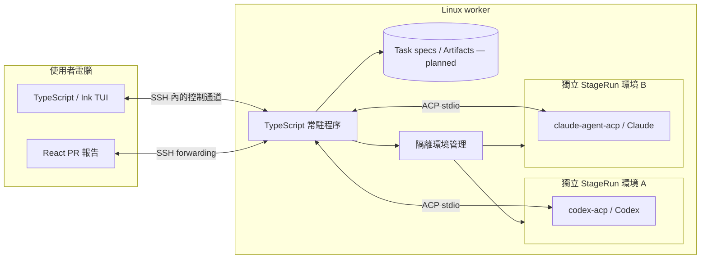

# Agent 工作台開發計畫

2026-10-23 project overview: the TUI roster groups Runs by project with one line per project naming its next action and active Phase. `work.ProjectWorkspaces.overview()` owns the Next action ranking (urgent actions rise; others keep launch order) and `startSession` owns the New Session inspect/register/launch/associate sequence. This was the next candidate named below; Candidate-bound evidence and independent Review remain next. See [Project overview](project-overview.md).

2026-10-22 priority change and first `delivery` slice: the user's main pains are losing progress across projects, not knowing what to do next and Diffs that are hard to understand, so a Change map now comes before Candidate-bound evidence. `delivery.describeChange` reads a Run worktree against its base (read-only, bounded) and returns files/declarations, module Interface changes and statically traced flows from a key press over the local HTTP route into the changed module code. TUI `m` / `:map` opens the browser page `/changes?run=…`; the authenticated `GET /api/changes` takes only a Run ID. It is not the M4 React PR viewer and not evidence. Next candidates: per-project progress and next-action ordering, then Candidate-bound evidence and independent Review. See [Change map](change-map.md).

2026-10-22 source setup: New Session now asks before initializing a non-Git folder and creating its first local commit of current non-ignored files. Empty Git repositories can create the first commit as well. `execution` owns source identity/state checks, a per-folder lock, Git initialization/snapshot and failure preservation; app owns explicit No/Yes UI and authenticated transport. Success returns to branch selection without starting a model. Older daemons retain manual setup, and ambiguous mutations are not replayed. See [New Session initialization](session-creation.md#initialize-a-project).

2026-10-19｜M0 runtime／CLI／fixture 瀏覽器測試台，以及 M1 第一個 Ink TUI／本機背景程序切片已實作；兩家真實 provider 與隔離驗收待完成，尚未達到完整 M0／M1 驗收。

Current decision: implement [explicit local Codex execution](local-execution.md) first, as requested on 2026-10-19. Local Git directory sources now use per-Run worktrees and private CLI homes; this is not OS security isolation. [Container isolation and actual results](isolation-results-plan.md) retains the proposed ownership/network/reconciliation design for later. No container provisioning or isolation acceptance has started.

2026-10-19 follow-up: the user chose [agent-authored progress reports](agent-progress.md), at most 50 words, rather than a rule-based semantic summary of chat/tool text. Local/fixture Sessions now receive a Run-specific MCP reporting tool; Timeline wraps its explicit reports and leaves ordinary conversation in Live. Real model compliance and quality remain unverified.

2026-10-19 live acceptance: a real Codex task again returned `workspace routing discovery failed` before tools or reports. Fixed a discovered prompt-order regression that blocked native slash commands; the real adapter's `/mcp` now confirms the local progress server is connected. Autonomous reporting and native approval/edit/in-flight cancellation remain incomplete. See [real Codex acceptance](codex-live-acceptance.md).

2026-10-20 decision: the user cancelled History and past-Run persistence. Run snapshots, events and approval receipts remain only in bounded daemon memory; TUI/browser have no History entry or paging. Reopening the TUI reattaches to a live daemon; a new daemon starts empty and cannot restore old Sessions or approvals. Existing archives are unused and left untouched. See [Run lifecycle](run-lifecycle.md). Next development target remains actual command/exit-code/log results tied to a Candidate, before independent Review/Verify. Native provider acceptance remains open alongside that work.

2026-10-20 design follow-up: the user proposed a task stepper (**Requirement clarification → Development → Agent Review → Human Review**) and a project Roadmap that shows the current implementation Phase and supports continued iteration. These are separate levels: Project → Phase → Task → Stage → Run. See [Roadmap and task stepper proposal](task-roadmap-proposal.md). Candidate-bound checks fit inside Agent Review; handoff gates and project-plan storage are proposals pending clarification, not implemented behavior. The earlier Dev/Review/Verify/PR role breakdown remains a source of internal responsibilities rather than additional visible steps in the proposed four-step UI.

2026-10-20 presentation clarification: retain the original compact Run workspace, adding only a small stepper and an expandable Roadmap window for a selected tracked Run. The revised standalone concept is `output/run-workspace-roadmap.html`; direct Runs hide tracking. Optional mode activation and an agent proposal tool remain under discussion. This is a concept update, not an implemented `work` Module or provider capability.

2026-10-20 implementation: the first `work` slice now supports explicit Roadmap opt-in, Phase/Task planning, versioned requirements confirmation, current-stage tracking, Run attachment/Direct mode, project-plan files and Task context on subsequent prompts. TUI/browser use the approved compact presentation. Planning state survives restart; Runs, permissions and associations do not. Review/check execution, Candidate evidence, Task/Phase acceptance, automatic handoffs and the proposal tool remain next slices. See [Roadmap operation, Interface and module map](roadmap-operation.md).

2026-10-21 local Codex acceptance: the same project-reading probe failed with restricted connectivity and passed with approved network access. Real Codex then confirmed sample Task requirements, edited code with a Diff, passed independent checks, completed genuine once-only allow/reject decisions, and stopped an observed active command on cancellation. Added opt-in `npm run qa:codex` and fixed upward Git discovery from Run copies. Build and 84 source tests passed. Physical-terminal acceptance, Claude and isolation remain open; next implementation target is Candidate-bound command/exit-code/log evidence before independent Review and Human Review acceptance. See [scoped live results](codex-live-acceptance.md).

2026-10-21 workspace follow-up: user requested Git worktrees before Pods, with clean close/GC and an explicit commit reminder for changed worktrees. Implemented local directory-source worktree/branch creation, staged/unstaged/untracked checks after process shutdown, a stopped `Commit required` action, explicit local-branch commit followed by collection, and retryable retention on commit/ownership/lock failures. No new worktree-count setting/limit or remote push. New Session project selection and crash reconciliation remain separate work. See [worktree operation and Interface](worktrees.md).

2026-10-21 New Session implementation: `n` now opens a compact agent/project/starting-branch form. Normal project choice no longer needs launch JSON or an environment variable; the standard server offers explicit local Codex and Fixture presets. Saved local branches seed fresh worktrees without restoring conversations. Execution owns Git discovery and pinned-base validation; work owns separate project plans, Run associations and Task-context routing. TUI/browser project context follows selection. Old daemons retain their original controls. The real Codex form/edit/approval/cancel/commit workflow passed on disposable source; independent Candidate-bound check evidence and Review/Human Review remain the next development target. See [New Session](session-creation.md).

2026-10-21 path-selection follow-up: implemented TUI Tab folder completion with a compact three-row, width-adaptive `ls`-style grid and native semantic colors/text markers, plus an independently focusable Agent field. The selected candidate uses inverse video; arrows navigate cells/pages, Tab advances, and shortened names still fill their full paths. Execution owns authenticated, bounded one-level source-folder discovery before Git validation; editing/focus/close invalidates pending UI reads. This does not enable ACP filesystem callbacks or read file contents. The grid refinement changes app presentation and input routing only, with no domain/transport change or daemon restart. See [New Session operation](session-creation.md).

**目標與選型**

使用者在同一個 terminal 工作台管理多個專案的 Codex／Claude：提出需求、查看串流與工具紀錄、回答問題、核准操作、追蹤 Dev → Review → Verify → PR，並透過有程式碼與驗證依據的互動報告理解交付。

第一版已選定 TypeScript + Node.js，TUI 採 React + Ink，PR 報告採 TypeScript + React。使用者要求依 domain 劃分並遵守 deep module 理念：用小且完整的 Interface 封裝行為、規則與失敗處理，讓程式碼可閱讀、可驗收、可定位問題。被開發專案的語言由各自的環境與 agent profile 支援，不受工作台語言限制。

介面以使用者指定的 [Noopher-AI/oat-agents](https://github.com/Noopher-AI/oat-agents) 為參考：緊湊的 agent roster、細框線與選取 Run 的詳情分頁。核准與回覆仍在本工作台處理。`preview/index.html` 是獨立 HTML + CSS + JavaScript 原型，直接開啟即可試用；`output/agent-workbench-preview.html` 是先前的對話內預覽。兩者均使用示例資料，不能視為 ACP 或真實執行已完成。

| 部分       | 建議                                           | 用途                                              |
| ---------- | ---------------------------------------------- | ------------------------------------------------- |
| 常駐程序   | TypeScript、受支援的 Node.js LTS               | 管理 sessions、核准、排程、事件與恢復             |
| TUI        | TypeScript、React、Ink                         | 集中 inbox、任務切換、對話與 diff                 |
| Agent 通訊 | ACP v1、`@agentclientprotocol/sdk`             | 統一 Codex／Claude 的結構化資料與雙向互動         |
| 儲存       | 有界記憶體；後續 Task／artifact 儲存待切片設計 | 當前 Run／timeline 不落盤；後續保存規格與驗證產物 |
| 隔離執行   | Linux worker 上的獨立 containers／clones       | 執行各階段的 agent、工具、測試與瀏覽器            |
| PR 報告    | TypeScript、React                              | 顯示互動流程圖、diff、驗證與 PR comments          |

ACP 提供 [TypeScript client SDK](https://agentclientprotocol.com/libraries/typescript)；[Ink](https://github.com/vadimdemedes/ink) 提供 React 的 terminal renderer。M0 確認 adapter capabilities 與 Node LTS 的相容性，釘選正式發布且互相相容的版本。Provider adapters 與各家 CLI 在隔離環境中保留必要 runtime。

**效率判斷**

目前尚無本產品 benchmark。預期主要等待來自模型服務、網路與外部工具；這是待量測的工作負載判斷，不能推導固定的語言速度倍數。Node 能非同步管理多個外部程序；工作台本身的改善不能直接當成 agent 端到端交付的加速。[Node 子程序](https://nodejs.org/api/child_process.html)

第一版先限制記憶體中的 log 視窗並合併文字串流的畫面更新，不提供 Run 歷史存檔。後續驗證的大型輸出依 artifact 切片設計保存。CPU 密集的 diff／解析工作需與核准、取消和 UI 輸入分開處理；實際優化以 profiling 決定。

需要避免 CPU／同步工作阻塞事件迴圈；經 profiling 確認的重計算先移到 worker thread 或獨立程序。未出現具體瓶頸前，不安排跨語言重寫。[Node 效能指引](https://nodejs.org/learn/asynchronous-work/dont-block-the-event-loop)、[worker threads](https://nodejs.org/api/worker_threads.html)

**Agent 交付方式**

M0 的交付包含模組地圖、啟動／除錯指引、核准與取消流程說明。TypeScript 採 strict 設定、明確的狀態 union 與執行期輸入驗證；不以型別斷言掩蓋未知的 provider 資料。每個切片須說明變更行為、所屬 domain、Interface 的不變條件、測試結果與未驗證項目；測試透過 Module 的公開 Interface 驗證可觀察行為。

**第一版的工作假設**

- 單人使用，主要介面是 macOS terminal；跨專案、兩家 provider，預設同時執行兩個階段，並發數可設定。
- 本機 TUI 連到遠端 Linux worker 上的常駐服務。關閉 TUI 或本機離線時，遠端服務繼續維持 agent 與核准請求。worker 的實際位置、資費與登入方式尚未選定。
- 若偏好全部在本機執行，可將相同服務放進本機 VM；此模式仍會使用本機運算資源。
- 第一版管理由工作台啟動或經確認可恢復的 sessions；既有 CLI tabs 的接管能力不作為前提。
- 日常控制留在 TUI；完整互動式 PR 圖在瀏覽器報告呈現，TUI 同時提供摘要、diff 與驗證結果。

**執行架構**



TUI 與常駐服務使用本產品的 command／event API；daemon 與 adapter 使用 ACP。ACP 的完整遠端傳輸支援仍在發展，第一版由 daemon 在 worker 端接 container 內的 stdio，避免依賴尚未確認的遠端功能。[ACP 架構](https://agentclientprotocol.com/get-started/introduction)

直接使用現有 [codex-acp](https://github.com/agentclientprotocol/codex-acp) 與 [claude-agent-acp](https://github.com/agentclientprotocol/claude-agent-acp)。它們分別包裝 Codex App Server、Claude Agent SDK；兩家 capabilities／extensions 的差異由整合層保留。遇到缺口才評估原生介面，不重寫 agent 的模型迴圈。

Daemon、TUI 與 PR viewer 是執行入口。業務行為放在下列 domain Modules；Interface 隱藏 provider、儲存與程序管理的 Implementation。

**依 domain 設計 deep Modules**

初期是一個產品脈絡下的模組化程式，先不把每個 domain 拆成獨立部署。術語見根目錄 `CONTEXT.md`，未來開發規則見 `AGENTS.md`。

| Domain Module | 擁有的行為與規則                                          | 對外 Interface 的行為示意                    | 內部隱藏的 Implementation                                                                       |
| ------------- | --------------------------------------------------------- | -------------------------------------------- | ----------------------------------------------------------------------------------------------- |
| `work`        | 需求、Task spec、依賴、階段順序、排程與有限重試           | 定義任務、啟動任務、查詢進度                 | PM 輸出轉 task、階段推進與資料持久化                                                            |
| `execution`   | 單次 Run 的 session、輸入、取消、隔離與服務生命週期、恢復 | 啟動 Run、送入指令、取消 Run、觀察 Run／服務 | ACP、Codex／Claude adapters、callback 對應、container、terminal／檔案操作、服務啟停／健康／logs |
| `attention`   | 人工決策的等待、回答、交付狀態、過期與去重                | 提出決策請求、列出待辦、回覆、讓 scope 失效  | 記憶體內等待中的決策、通知去重與已回答／已送達的區分                                            |
| `evidence`    | Candidate 身分、Artifacts、Review／Verify 證據與通過條件  | 記錄證據、評估候選版本、讀取證據             | 檔案儲存、schema 驗證、SHA／spec revision 比對與證據失效                                        |
| `delivery`    | PR 說明、互動報告、發佈對帳與 comments                    | 準備交付、發佈交付、同步 comments            | GitHub 整合、報告資料組裝、行號／SHA 對應與重複發佈處理                                         |

上表是行為層設計，實際方法與資料結構由每個切片的需求收斂。Interface 包含呼叫者必須知道的不變條件、順序、錯誤與效能限制；Depth 以呼叫者能取得多少完整行為衡量，不以檔案長度或方法數量判斷。

```text
src/
  work/          index.ts + internal/
  execution/     index.ts + internal/{acp,sandbox,...}/
  attention/    index.ts + internal/
  evidence/     index.ts + internal/
  delivery/     index.ts + internal/
  app/          daemon、TUI、依賴組裝與傳輸入口
```

目錄隨里程碑按需建立。每個 Module 的 `index.ts` 是 external Seam；其他 domain 與呼叫者不匯入其 `internal/`。每個 domain 自己持有規則、儲存存取與錯誤轉換；不另外設計全域 `services/`、`repositories/`、`controllers/` 來承載散落的業務知識。PR viewer 在 M4 加入，使用 `delivery` 的公開資料契約。

`work` 協調 `execution`、`evidence` 與 `delivery`；`execution` 透過 `attention` 取得決策；`delivery` 使用 `evidence` 判斷交付依據。下游 Module 不反向依賴上游；結果經公開結果／事件回傳。`app` 只組裝依賴與轉接使用者輸入，不持有階段推進或證據通過規則。

ACP 的兩個 provider adapters 是有真實差異的 Seam；儲存與隔離先各做目前需要的 Implementation，不為想像中的替代選項新增泛用工廠或層層介面。共用內容限必要的 ID／事件格式；各 domain 的契約仍由該 domain 擁有。

具體的不變條件：

- TUI 透過 `attention` 的公開資料回覆決策，無需知道 ACP request ID、連線世代或 provider option ID。`execution` 保留映射並在送出前確認請求仍有效；畫面分別顯示已接受回覆與已送達 agent。
- `work` 要求執行一個 Run，無需自行啟動 adapter、掛載目錄或收拾子程序；這些由 `execution` 完成。
- `evidence` 以 Task spec revision 與 Candidate SHA 判斷證據，回傳 passed／failed／incomplete 及原因；上層不各自重做比對。
- `delivery` 準備 PR 時重新取得對應證據與檢查結果，呼叫者不能用 `verified: true` 布林值跳過驗證。
- 同一 Run 的重複回覆、取消或失效請求，不會藉由 UI 重繪重複執行外部操作。

模組設計的驗收：更換 provider 的協定細節只改 `execution`；新增 Python profile 不新增一個 Python domain；改 TUI 不改任務流程；變更 candidate 後，證據與交付的失效規則只在所屬 Module 處理。若刪除某 Module 只少了轉呼叫，它偏 shallow；若刪除後使多個呼叫者被迫處理同一批複雜規則，才有應保留的 Depth。

**必須先分清楚的資料**

| 名稱           | 定義                                                            |
| -------------- | --------------------------------------------------------------- |
| Project        | 一個 repository 與其驗證設定                                    |
| Task           | 一份需求、驗收條件、依賴與預期交付                              |
| Run            | 一個 Role 的一次執行；重試產生新的 Run；PM 討論也可有自己的 Run |
| StageRun       | 某個 Task 在 Dev／Review／Verify／PR 的 Run                     |
| Session        | Run 內的一段 agent 對話；不等同整個 Task                        |
| Candidate      | 可重建的程式碼候選版本，綁定 commit SHA                         |
| Attention item | 等核准、等回答、執行失敗或需決策的具體事項                      |
| Artifact       | diff、review findings、測試紀錄、圖與 PR 描述等有來源的產物     |

任務完成、agent 回合結束、工具執行成功各自是不同狀態。完成 agent 回合只代表停止回覆；階段通過必須符合驗收與證據規則。

**核准、timeline 與恢復規則**

- Inbox 以「任務、階段、等待原因、等待多久、需做什麼」呈現；核准與提問可直接回覆。失敗與未讀完成另有類型，避免全部顯示成 waiting。
- 每筆核准保留 session、連線世代、原始 request ID、工具內容與 provider 提供的 options，回覆精確對應的選項 ID。一般工具 pending 狀態不自動推定為等核准。[ACP 核准流程](https://agentclientprotocol.com/protocol/v1/tool-calls)
- 核准回答、取消與重複按鍵由 daemon 序列化處理。過期或已回答的請求不再次送出；取消時處理該階段的未決請求與所管理的背景程序。
- Agent 提問依實際能力轉為結構化選項或一般對話；M0 實測兩家能力。執行中的一般指令若不支援 steering，就明確排入下一回合，不假裝已即時送達。
- Timeline 在本次程序的有界記憶體保存有序事件與必要的 provider 資料；execution 擁有 Run 快照／事件，attention 擁有核准收據，不使用 Run 歷史資料庫。後續驗證 artifact 另行設計。憑證不寫入事件或可分享報告。
- TUI 重新連線時，先取得快照，再從 event cursor 補上新事件；關掉 TUI 不會結束 daemon。
- Daemon 崩潰會使活躍傳輸失效；新程序從空白開始，不恢復 Run 或舊核准。外部執行環境的資源對帳仍是後續工作，需獨立於已取消的 Run History 設計。
- 單一大量輸出的 session 不得讓其他任務的核准與按鍵無法處理。

**隔離與階段交接**

每個 Run 使用自己的 clone、依賴、暫存目錄、服務與瀏覽器環境；Task 各階段的 Run 稱為 StageRun。Agent 與 adapters 也在該環境中。使用者本機專案與全域設定不提供可寫掛載。Profile 注入當次執行需要的 provider 設定與工具，避免共用可寫的 CLI home。

ACP client 可以提供檔案與 terminal 能力，這些 callback 必須路由到對應 StageRun 環境；尚未完成隔離路由的能力不宣告支援。[ACP 檔案能力](https://agentclientprotocol.com/protocol/v1/file-system)、[terminal 能力](https://agentclientprotocol.com/protocol/v1/terminals)

階段以 task spec、候選 commit 與結構化 artifacts 交接，不共用整份對話。候選程式碼以 worker 內的 Git refs／bundle 保存，讓下一個環境能重建；不需要每個階段都 push 到 GitHub。

| 階段   | 主要輸入                                   | 必要輸出與門檻                                        |
| ------ | ------------------------------------------ | ----------------------------------------------------- |
| PM     | 使用者需求與專案脈絡                       | 範圍、驗收條件、依賴、task spec；範圍依使用者討論定案 |
| Dev    | Task spec、base commit、技術 profile       | Candidate SHA、diff、實作摘要、已執行的檢查           |
| Review | Spec、candidate、diff、repository          | 有檔案／行號／SHA 的 findings、嚴重程度與處理狀態     |
| Verify | Spec、candidate、專案檢查設定              | 真實執行命令、exit code、log、環境版本與未驗證項目    |
| PR     | 同一 candidate 的 review／verify artifacts | PR 描述、影響流程、證據連結、draft PR 與 comment 對應 |

Review 與 Verify 各自開新 session／環境。Verify 在乾淨候選版本依驗收條件執行；agent 的口頭「已測試」不能直接當成通過。檢查結果包含 passed／failed／skipped／unknown，記錄實際覆蓋範圍。若 review／verify 產生需要提交的修正，回 Dev 建立新 candidate；新 SHA 必須重新產生 review 與 verify 結果。

工作流採 Dev → Review → Verify → PR。Findings 回 Dev，重試有上限，超過後進 inbox。不同獨立任務可並行；相依任務需等待前置候選可用。第一版預設一個 task 一個 PR；整合或 rebase 改變 SHA 後重新驗證。

Role 與技術 profile 分開：例如「Review + Python + Claude」或「Dev + TypeScript + Codex」。Profile 記錄 provider、skill／plugin 來源與版本、工具能力、runtime image、驗證命令；啟動時保存設定快照。這是工作台自己的設定模型，各 provider 原生設定透過整合層轉換。CLI 的 skills／plugins／登入能力必須逐項驗證，不能假設經 adapter 後完全相同。

**五個里程碑**

| 里程碑               | 可交付結果                                       | 驗收條件                                                                                                                                                                                                                       |
| -------------------- | ------------------------------------------------ | ------------------------------------------------------------------------------------------------------------------------------------------------------------------------------------------------------------------------------ |
| M0：整合驗證         | 最小 TypeScript ACP client + 隔離 fixture repo   | 從 `execution` 與 `attention` 的切片開始；兩家各實跑文字、工具、diff、允許／拒絕核准、提問回覆、取消；確認登入方式、版本與能力差異；本機原 repo 不變；留下公開 Interface、能力矩陣與操作指引                                   |
| M1：集中工作台       | TUI、daemon、inbox、timeline、Services           | 兩個專案混用兩家 agent；左側專案／來源位置、Run 隔離路徑；原地回答／核准／下指令；各 Environment 可啟停前後端／DB、查看健康與 logs，故障進 inbox；關 TUI 後任務存活，重開連回同一 daemon；新 daemon 從空白開始且不能操作舊核准 |
| M2：完整任務流程     | 手動建 task 後跑 Dev → Review → Verify → PR 準備 | 各階段獨立 context／環境；真實案例完成全部階段；故意修改 candidate 後，舊證據失效；可產出完整 PR 草稿                                                                                                                          |
| M3：PM 與 profiles   | 對話拆 task、依賴與並行排程                      | PM 產出的 task spec 經 schema 驗證，範圍定案後交 runner；並發／重試有界；可切換 provider 與 Python／TypeScript profile                                                                                                         |
| M4：可理解的 PR 交付 | 互動報告、draft PR 與 comments                   | Before／after 圖節點可定位到 code／diff／證據；分開顯示已驗證與推論；PR comments 綁定 SHA；建立 PR 前後對帳避免重試造成重複                                                                                                    |

M0、M1 是第一個可日常使用的版本；M2–M4 完成原本提出的開發與交付流程。每一階段都保留可獨立運行的成果，依實測調整後續範圍。工期在 M0 確認整合與登入限制後再估。

PR 互動報告由固定 React 元件渲染結構化資料，連到真實程式碼與證據。模型負責解釋與建議，renderer 負責顯示；未執行的驗證明確標示。先前 `output/pr-change-explainer.html` 僅是使用假資料的互動概念，不能當成真實分析。

**驗證重點與效能基線**

- 協定測試：交錯事件、重複／延遲核准、取消、adapter exit、缺少 capability；另以真實兩家 sessions 驗證。
- 流程測試：review findings、verify 失敗、重試上限、candidate SHA 改變、依賴任務與恢復；涵蓋任務成功與失敗路徑。
- 隔離測試：本機 repo／全域設定前後比對；檔案與 terminal callback 僅操作指定環境，不能越到另一個 StageRun。
- 效能先用四個 session 的可重播串流，記錄事件量、硬體、TUI 與 daemon 的 CPU／RSS、event loop lag、輸入與核准事件到畫面的 p50／p95。再以真實 session 校正；不預設兩種語言的倍率。
- 初始互動目標：在所記錄的測試負載下，工作台收到核准事件到畫面顯示的 p95 小於 200ms（不含網路傳輸）。這是驗收目標，尚無測量結果；隨歷史 log 增長，常駐記憶體需維持有界。

**實作前尚需落定的項目**

Worker 位址與佈署模式、兩家可用登入方式、首個真實試跑 repository、該 repo 的驗收命令，以及 GitHub 發佈／PR 權限。M0 已安裝鎖定的本地依賴，建立可信 fixture 子程序與測試目錄；尚未連接模型帳號、建置 worker image、執行真實 provider 或發佈 PR。

本輪已實作 M0 的 `execution`／`attention` 公開 Interface、TypeScript CLI、ACP v1 fluent client、固定 fixture、事件匯出／重播、private container／network 的 Docker／SSH 啟動邏輯。17 個公開 Interface／CLI 行為測試通過，包含兩個 stdio 子程序、核准映射與競態、取消、異常退出、來源 fixture 不變與清理。

完整 M0 尚待真實兩家 provider 往返與 worker 隔離驗收。直接 shell 的 Docker socket 存取被拒；`npm run doctor` 的 Node 子程序則讀到 Docker Server 28.0.4。命令路徑的可達性結果不同，尚未據此啟動 container；缺少遠端 worker 與登入設定。操作、能力與缺口見 `docs/m0-operation.md`、`docs/m0-capability-matrix.md`。

使用者在精簡瀏覽器 Demo 後已要求進入下階段。M1 第一個切片提供 `npm run tui` 的 React + Ink 畫面、同 port 背景 server、自動啟動／重新附著與明確停止；核准、timeline、回覆、取消仍用 domain 公開 Interface。退出 TUI 不取消 Run；依 2026-10-20 決定取消 History，server 程序重啟後從空白開始。遠端常駐部署、崩潰後環境對帳、Services、多專案或真實兩家 provider 尚未完成。此切片的範圍、Interface 影響與驗證記錄見 `docs/tui-operation.md`、`docs/run-lifecycle.md`。
